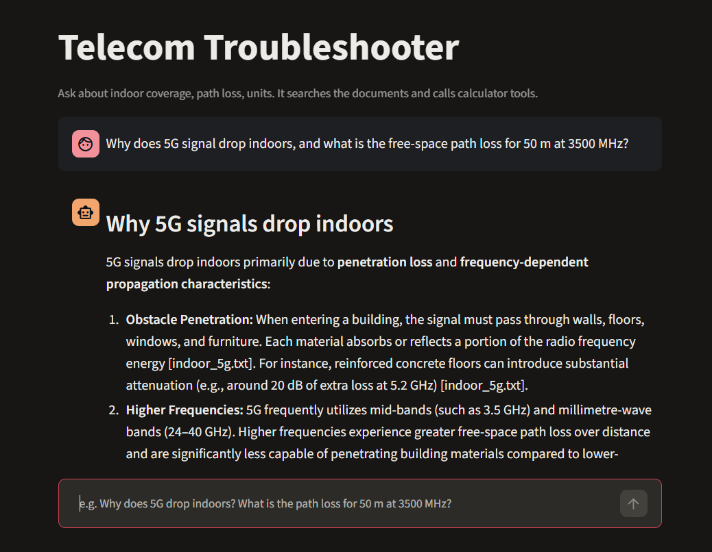

# Telecom Troubleshooter


**Live demo:** https://telecom-troubleshooter-jvs7bnnke6xsmgvlhcdwgv.streamlit.app/



An AI agent that answers telecom questions by combining **document search (RAG)** with **calculator tools**. Ask why indoor 5G coverage is weak and it retrieves the relevant theory with sources. Ask for a path-loss figure and it calls a tool to compute it. A "Show your work" panel lists every source and tool call behind the answer.

## How it works

1. **Load and chunk:** `.txt` and `.pdf` files in `docs/` are split into overlapping chunks, with source and page metadata. Table-of-contents chunks are filtered out.
2. **Embed:** chunks are embedded locally with `sentence-transformers/all-MiniLM-L6-v2`, so there are no embedding rate limits.
3. **Search:** an in-memory vector store returns the top matching chunks for a question. The index is cached in `store.json`.
4. **Agent loop:** Gemini decides whether to search the documents or call a tool. The code runs the tool and sends the result back to the model, repeating until it can answer. A step limit stops runaway loops, and tool errors are returned to the model as text so it can recover.

### Tools

| Tool | What it does |
|---|---|
| `search_telecom_docs` | Retrieves relevant passages with their source and page |
| `dbm_to_watts` | Converts power from dBm to watts |
| `wavelength_m` | Wavelength in metres from frequency in Hz |
| `free_space_path_loss_db` | Free-space path loss from distance (km) and frequency (MHz) |

## Example

```
Question: Why does 5G signal drop indoors, and what is the free-space path loss for 50 m at 3500 MHz?

[tool] search_telecom_docs {'question': 'Why does 5G signal drop indoors?'}
[tool] free_space_path_loss_db {'distance_km': 0.05, 'freq_mhz': 3500}

Answer: penetration loss and frequency effects, with sources cited.
Free-space path loss: 77.30 dB.
```

## Project structure

```
main.py        # embeddings, chunking, vector store, search
tools.py       # calculator functions
agent.py       # tool calling and the agent loop
app.py         # Streamlit demo
test_tools.py  # pytest tests for the calculators
docs/          # your documents (.txt and .pdf)
assets/        # screenshots
```

## Setup

```
python -m venv .venv
.venv\Scripts\Activate.ps1
python -m pip install -r requirements.txt
```

Create a `.env` file with your Gemini API key:

```
GEMINI_API_KEY=your_key_here
```

Optional: choose the Gemini model with `GEMINI_MODEL` (default: `gemini-2.5-flash-lite`).

Add documents to `docs/`. The ITU PDFs used in development (ITU-R P.1238 on indoor propagation and ITU-R M.2083 on the IMT-2020 vision) are free to download from itu.int and are not included in this repo. The `.txt` notes in `docs/` are original.

## Run

Command line:

```
python agent.py
```

Web demo:

```
python -m streamlit run app.py
```

The first run downloads the embedding model (about 90 MB) and builds `store.json`. Later runs load the saved index. **Delete `store.json` after changing anything in `docs/`.**

## Tests

```
python -m pytest
```

The calculator tests run in GitHub Actions on every push.

## Docker

```
docker build -t telecom-troubleshooter .
docker run -p 8501:8501 --env-file .env telecom-troubleshooter
```

Then open http://localhost:8501. The API key is passed at run time and is never baked into the image.

## Limitations and next steps

- The index is rebuilt from scratch whenever the documents change.
- A small local embedding model ranks results less accurately than larger ones.
- Each question is independent, so the agent has no memory across turns.
- Next: a retrieval evaluation script (hit rate on a set of test questions), more tools (link budget, coverage radius), and a CD workflow that builds and publishes the Docker image.